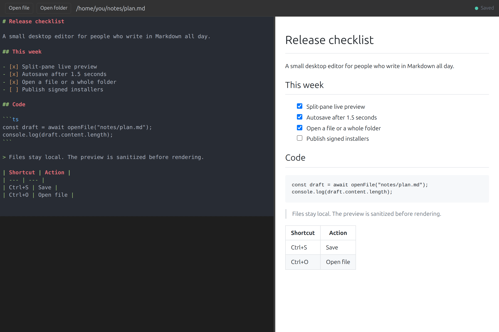
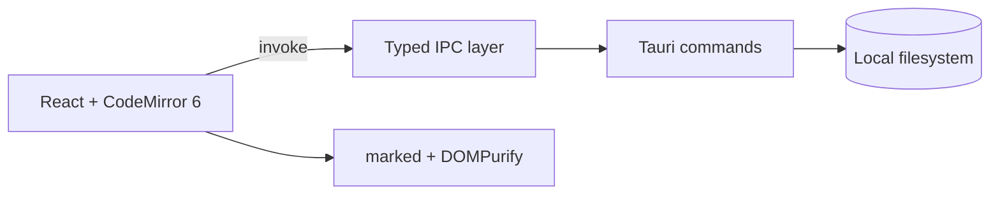

# MD Editor

A focused desktop Markdown editor with live preview, a file-tree workspace, and
autosave. Built with Tauri 2, React 19, TypeScript, and Rust.

[](https://github.com/Zeusse-Neumbi/md-file-editor/actions/workflows/ci.yml)
[](LICENSE)
[](https://github.com/Zeusse-Neumbi/md-file-editor/releases)



## Why

Most Markdown editors either bury the preview behind a toggle or turn a single
file into a project. MD Editor keeps the source and rendered output side by
side, and adds a workspace tree only when you open a folder.

## Features

- **Split-pane editing** — Markdown source on the left, rendered preview on the right
- **Live preview** — GitHub Flavored Markdown with syntax highlighting
- **Autosave** — saves 1.5 seconds after you stop typing
- **Manual save** — `Ctrl+S` / `Cmd+S`
- **Single-file and folder modes** — open one `.md` file or a whole workspace
- **File tree sidebar** — browse and switch between Markdown files
- **Drag and drop** — drop a `.md` file or folder onto the window
- **Keyboard shortcuts** — open file, open folder, toggle the sidebar, save
- **XSS protection** — rendered HTML is sanitized with DOMPurify before display
- **Unsaved-changes prompt** — save before closing the window

## Install

Installers are published on the [Releases page](https://github.com/Zeusse-Neumbi/md-file-editor/releases).
The release workflow builds:

| Platform | Packages |
| --- | --- |
| Linux | `.deb`, `.rpm`, `.AppImage` |
| macOS | `.dmg` |
| Windows | `.msi`, `.exe` |

Linux packages are unsigned. macOS and Windows builds are unsigned development
builds, so the operating system may show a warning on first launch.

## Build from source

### Prerequisites

- Node.js 20+ and npm
- Rust toolchain via [rustup](https://rustup.rs/)
- Linux system dependencies:

```bash
sudo apt update && sudo apt install \
  libwebkit2gtk-4.1-dev \
  build-essential \
  curl \
  wget \
  file \
  libxdo-dev \
  libssl-dev \
  libayatana-appindicator3-dev \
  librsvg2-dev
```

For macOS and Windows prerequisites, see the
[Tauri prerequisites guide](https://v2.tauri.app/start/prerequisites/).

### Run in development

```bash
git clone https://github.com/Zeusse-Neumbi/md-file-editor.git
cd md-file-editor
npm ci
npm run tauri dev
```

### Build a package

```bash
npm run tauri build
```

Artifacts are written to `src-tauri/target/release/bundle/`.

## Usage

Open a Markdown file with **Open file**, `Ctrl+O` / `Cmd+O`, or by dropping a
file onto the window. Open a folder with **Open folder**, `Ctrl+Shift+O` /
`Cmd+Shift+O`, or by dropping a folder onto the window.

When a folder is open, the sidebar lists its Markdown files. Click a file to
open it; the editor autosaves changes after 1.5 seconds, and `Ctrl+S` saves
immediately.

| Shortcut | Action |
| --- | --- |
| `Ctrl+O` / `Cmd+O` | Open file |
| `Ctrl+Shift+O` / `Cmd+Shift+O` | Open folder |
| `Ctrl+S` / `Cmd+S` | Save |
| `Ctrl+B` / `Cmd+B` | Toggle sidebar (folder mode) |

## Architecture



The frontend never touches the filesystem directly. File reads, writes, folder
listing, and file-status checks go through typed commands in `src-tauri`; the
Rust side validates paths and returns structured results. Markdown is rendered
with `marked`, sanitized with DOMPurify, and highlighted with `highlight.js`.

## Tech stack

| Layer | Technology |
| --- | --- |
| Desktop framework | Tauri 2 |
| Backend | Rust 2024 |
| Frontend | React 19 + TypeScript |
| Build tool | Vite 6 |
| Editor | CodeMirror 6 |
| Markdown | marked + highlight.js |
| Sanitizer | DOMPurify |
| State | Zustand 5 |
| Styling | Tailwind CSS 4 |
| Layout | react-resizable-panels |
| Tests | Vitest + Rust `#[test]` |

## Project structure

```text
md-file-editor/
├── src/                  # React frontend
│   ├── components/       # Editor, Preview, Sidebar, TitleBar, Toast
│   ├── lib/              # IPC wrappers, Markdown, file picker
│   ├── stores/           # Zustand editor state
│   └── __tests__/        # Vitest suite
├── src-tauri/            # Rust backend and Tauri configuration
│   └── src/commands/     # File and app commands
├── docs/                 # Screenshots and design notes
└── .github/workflows/    # CI and release automation
```

## Testing

```bash
npm test                  # 37 frontend tests
npm run typecheck         # TypeScript, no emit
cd src-tauri && cargo test # 15 Rust tests
```

The suite covers Markdown rendering and sanitization, store actions, editor
mounting, preview updates, and the sidebar. CI also runs `cargo fmt --check`,
`cargo clippy -- -D warnings`, and a production frontend build.

## Design notes

- **Filesystem access stays in Rust.** The React layer calls a small typed IPC
  surface instead of using browser filesystem APIs. That keeps path handling and
  error reporting in one place.
- **Autosave is debounced, not periodic.** A 1.5-second timer resets on each
  keystroke, so long writing sessions do not produce a write per character.
- **Markdown is untrusted input.** `marked` output passes through DOMPurify
  before it reaches the preview. The app does not render raw HTML from a file
  without sanitization.
- **The workspace tree is optional.** Single-file mode has no sidebar; opening a
  folder adds one and keeps the last-opened file in the editor.

## Limitations and next steps

- No multi-tab editing or split views beyond the editor/preview pane.
- No search-and-replace across a workspace.
- No Git integration or file watching yet.
- Release packages are unsigned, so macOS and Windows show first-launch
  warnings.
- Large documents are rendered in one pass; virtualized preview is future work.

See [CONTRIBUTING.md](CONTRIBUTING.md) for the development workflow and
[SECURITY.md](SECURITY.md) for vulnerability reporting.

## License

[MIT](LICENSE) © 2026 Neumbi Kemgang Zeusse
